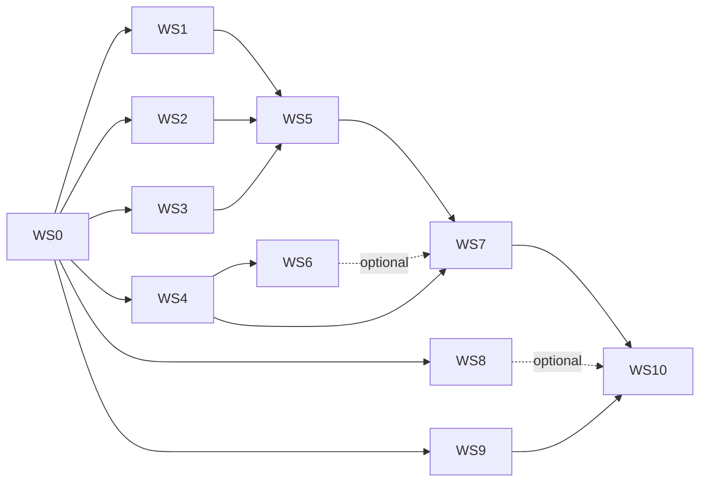

# Pigeon detector improvement plan

Plan for improving accuracy, speed, and reaction time of the Columba Zero
detector on a Raspberry Pi 5 with a Camera Module 3 Wide and a NoIR camera.
Written to be executed by one agent or by several agents in parallel git
worktrees, coordinated by one lead agent.

Companion files:

- [CONTRACTS.md](CONTRACTS.md): file formats and interfaces shared between
  workstreams. Read it before writing anything another workstream consumes.
- [status/](status/): one status file per workstream. Each workstream edits only
  its own file.

## 0. How to use this document

**Every agent** reads sections 0–6 and [CONTRACTS.md](CONTRACTS.md), then
its own workstream in section 7.

**The coordinator** (lead agent) also reads section 8, launches the
workstreams in the order shown there, merges branches, and enforces the
gates. Workers do not merge to `main`.

Working rules for worktree agents:

1. Branch name: `ws<N>/<short-slug>`, e.g. `ws1/evaluator`. One workstream per
   branch. Small commits.
2. Touch only the files your workstream owns (listed in section 7). If you
   need a change in a file another workstream owns, or in
   [CONTRACTS.md](CONTRACTS.md), stop and record the request in your status
   file under "Blockers". The coordinator decides.
3. Update `status/WS<N>.md` when you start, when you hit a blocker, and when
   you finish. Record results with paths to artifacts, and label every number
   as **measured**, **estimated**, or **simulated**.
4. Before declaring done: `python -m unittest discover -s tests -v`,
   `python -m ruff check app tests tools`, `python -m ruff format --check app
   tests tools`, and `python -m mypy` all pass. Include any new Python
   directories that exist (`cluster`, `training`) in the ruff commands. Add tests
   for new code the way the existing tests do.
5. Worktrees start from committed `main`. If you depend on another
   workstream's output, check that it has been merged first; do not copy
   uncommitted files between worktrees.

## 1. Goals and success criteria

Priorities, highest first:

1. **Pigeon detection accuracy**, especially few false alarms and good recall
   on small, distant birds. Only rock/feral pigeons (*Columba livia*) may trigger.
2. **Reaction time**: p95 **≤ 500 ms** from a pigeon becoming visible to a
   confirmed trigger decision (section 4).
3. **Per-frame speed** on the Pi 5, as needed for goal 2.
4. **Secondary:** detect and track common Singapore bird species for logging
   and display. These never trigger. Ship this only if it passes the gate in
   section 5.4.

A model is promoted to deployment candidate when it meets all of these:

| Criterion | Requirement |
|---|---|
| Primary accuracy | Higher `pigeon_recall_at_p90` on `columba-test-v2` than the incumbent (3-seed mean beats incumbent mean by more than the larger seed std dev) |
| False alarms | `empty_false_alarm_rate` ≤ 0.02 and `confuser_false_alarm_rate` ≤ 0.05, at the operating threshold chosen on the validation split |
| Per-frame latency | Estimated Pi 5 p95 end-to-end ≤ 100 ms (hard limit); target ≤ 70 ms |
| Reaction time | Simulated p95 ≤ 500 ms using `tools/reaction_budget.py` (WS4) |
| Export parity | NCNN export matches its PyTorch source within `compare_exports.py` tolerances (looser, documented tolerances for int8) |

The incumbent starts as `pigeon_baseline_v1-2`, re-scored on
`columba-test-v2` (WS1). Absolute targets will be set after that honest
baseline exists. Until then, success is relative to it.

## 2. Decisions already made (do not re-ask)

| Topic | Decision |
|---|---|
| Framework | Ultralytics is acceptable (AGPL-3.0 is fine). YOLO is the default family; challengers are optional (WS6). |
| Trigger classes | Pigeons only. Native doves and pigeons (e.g. spotted dove, zebra dove, pink-necked green pigeon) are confusers and must not trigger. |
| Other species | Secondary. Ship only if they don't hurt pigeon accuracy or latency (section 5.4). |
| Reaction time target | About 0.5 s, p95. |
| GPU budget | At most **4 GPUs** at a time for this project. |
| ARM node use | `xcng0-1` may be used for anything where it fits better than the Mac, including latency estimates. Avoid queueing many jobs; prefer local Mac work for quick iteration. |
| Restricted hardware | A100, H100, H200 and `xgpj0` belong to a higher-priority project. Do not use them. |
| Native code | C++ preferred over Rust (section 7, WS8). |
| No cloud instances | Use the Mac and the SoC cluster only. |

## 3. Current state (facts as of 14 Oct 2026)

Repository:

- Runtime: `app/`. Picamera2 capture at 640×480, Ultralytics `YOLO.predict`
  on an NCNN export at 640×640 with `rect=False`, single class `pigeon`, fixed
  confidence threshold 0.5, no temporal filtering. Detection, rendering and logging
  run serially on the main thread. Capture runs on its own thread
  (`app/capture.py`).
- `app/detector.py` requires exactly one class named `pigeon` and a square
  NCNN export. `app/config.py` rejects a `tracking:` config section as
  obsolete; new tracking settings must use a different section name or a migration.
- Model: `runs/detect/pigeon_detector/pigeon_baseline_v1-2/` (YOLO11n,
  640, stopped at epoch 60 with patience 10; best at epoch 50). Never modify
  this directory.
- Training data: about 1.1k images (Roboflow pigeon sets plus COCO birds
  relabelled as pigeon). Many large close-up boxes. Test split: 63 images, all
  contain pigeons. Split leakage has not been audited.
- Recorded test metrics: P 0.905, R 0.832, mAP50 0.905, mAP50-95 0.573
  (`deploy/pt_test_metrics.json`). Probably optimistic (no negatives, unaudited
  splits).
- Tools: `tools/` (train, evaluate, export, compare exports, benchmark,
  dataset audit, summarise run). Tests: `tests/` (41 unittest cases).
- `weights/yolo26n.pt` is present; whether Ultralytics 8.4.175 supports it
  fully needs checking (WS0).

Hardware:

- Pi 5 and cameras are **not available yet**. No Pi measurements exist.
- The Pi 5's Cortex-A76 reports CPU flags `fp asimd aes pmull sha1 sha2 crc32
  atomics fphp asimdhp asimdrdm lrcpc dcpop asimddp`: fp16 arithmetic and int8
  dot-product, but no i8mm, bf16, fp16 FML or SVE. Confirm on the Pi (WS10).
- Mac: Apple Silicon (ARM64), with more CPU features than the Pi, so NCNN picks
  different kernels unless it is built with them disabled (WS4).

SoC cluster (`ssh columba-cluster`, see section 6):

| Item | Fact |
|---|---|
| Per-user QoS | Max **16 running** jobs, **32 submitted**; max **8 GPUs total**, 256 CPUs. Shared with the user's high-priority project (jobs named `moonshot-*`). |
| This project's budget | ≤ 4 GPUs, ≤ 2 CPU jobs, ≤ 12 jobs in queue at a time. |
| Priority | Multifactor, dominated by fair-share; usage half-life 10 days; the user's fair-share is already low. |
| Billing weights | `nv` GPU 4, a100-40 6, a100-80 12, h100-47 8, h100-96 16, h200 48; CPU 0.5 each. |
| `gpu` partition | 3 h limit. |
| `gpu-long` partition | **3-day limit**; nodes with T4 (16 GB, sm_75), Titan RTX (24 GB, sm_75), Titan V (12 GB, sm_70). |
| ARM CPU | `xcng0-1`: Ampere Altra Max, **Neoverse-N1** (same CPU flags as the Pi 5's A76), 128 cores, 1 TB RAM, 3.2 TB local NVMe. Partitions `normal` (3 h) and `test`. |
| ARM + GPU | `xgpj0`: Neoverse-N1 + A100-80. **Do not use** (A100). |
| AMD MI50 | `amdgpu0-3` resolve in DNS but are not in Slurm and SSH times out. Unavailable. |
| Software | Ubuntu, Python 3.12.3, NVIDIA driver 580 (CUDA 13.0). No `module`, conda, Apptainer or Docker; no sudo. Compute nodes have internet. |
| Storage | `/home` is NFS, 95% full cluster-wide (≈8 TB free); user home ≈24 GB used. Node-local `/tmp` is large (3.2–3.5 TB on probed nodes). |
| Not in Slurm | `xgpc` V100 nodes listed on DocHub. |

## 4. Reaction-time budget

Definition: **reaction time** is the time from the first camera frame in which a
pigeon is visible to the moment the runtime logs a confirmed pigeon
trigger decision. Actuation is out of scope; the runtime has no GPIO.

Model (implemented by `tools/reaction_budget.py` in WS4):

```
T_react = T_sensor        exposure + readout + ISP + delivery ≈ 1–2 camera frame periods
        + T_wait          time until the processing loop picks up the frame (0 … one processing period)
        + T_confirm       further processed frames needed to reach k hits in the last n
        + T_proc          preprocess + inference + postprocess + decision for the confirming frame
```

`T_confirm` depends on per-frame pigeon recall, so the tool runs a Monte
Carlo over frame-level hits. Starting budget:

| Parameter | Value |
|---|---|
| Camera frame rate | 30 FPS (≈33 ms period). Night exposure capped at ≤ 1/60 s. |
| Processing period p95 | ≤ 70 ms target, ≤ 100 ms hard limit |
| Confirmation | k = 2 of n = 3 frames per track (k = 3 of n = 5 only if the false-alarm gate fails) |
| Result | ≈ 250–350 ms typical and ≤ 500 ms p95, if per-frame recall on visible pigeons is ≥ 0.8 |

Consequences:

- Only one camera is processed at a time by default: Wide by day, NoIR with
  an 850 nm illuminator at night, switched by light level with hysteresis.
  Processing both cameras at once halves each camera's frame rate. That only
  fits the budget if per-frame p95 ≤ 35 ms (open question Q1).
- Speed is only worth buying up to the budget. Once the selected model meets
  ≤ 70 ms p95, spend any remaining headroom on accuracy (bigger model or larger input).

## 5. Technical strategy

### 5.1 Data (largest expected accuracy gain)

- Freeze a new, honest test set, `columba-test-v2`. Deduplicate it and split by
  source or scene, so that near-duplicates never cross splits. Include empty
  scenes (≥ 30%), other birds and confusers (≥ 15%), and small birds (≥ 30% of
  pigeon boxes under 32 px on the short side at deploy input size).
- Training data v2: the current sources, cleaned and regrouped; more pigeon
  images; empty urban scenes as negatives; images of other Singapore birds.
  Images from iNaturalist research-grade observations with permissive licences
  get bird boxes from a COCO-pretrained detector and species from the
  observation's taxon. Auto-labels are reviewed on rendered contact sheets.
- Camera-style copies, kept in a separate, toggleable source and labelled
  `style`: simulated NoIR night (greyscale, IR illuminator falloff, noise,
  motion blur), simulated NoIR daytime (magenta cast, bright foliage), and
  simulated wide-lens geometry (barrel distortion with box remapping, zoom-out
  to small birds).
- Real site footage replaces simulation when hardware arrives (WS10).

### 5.2 Models

- Main line: Ultralytics YOLO26n/s and YOLO11n/s at 640, 300 epochs with
  patience 50, cosine LR schedule, Ultralytics' fixed nominal batch of 64
  (`nbs: 64`, which accumulates gradients so the effective batch doesn't depend
  on the GPU), 3 seeds per configuration.
- Teachers: YOLO11x and YOLO26x at 960, trained on `gpu-long` Titan RTX
  nodes. Used for automatic labelling and for distillation (`distill_model` /
  `dis` in Ultralytics 8.4.175; confirm the behaviour in WS0).
- Challengers (WS6, optional): D-FINE-N or DEIM-N, RF-DETR nano, and
  NanoDet-Plus. Each must pass a latency gate *before* any training (export a
  COCO-pretrained checkpoint and benchmark it).
- Deploy input: 16:9, multiples of 32 (`352×608`, `384×640`, `448×800`),
  fp16 and int8 NCNN.

### 5.3 Runtime

- 16:9 capture via Picamera2's low-resolution stream (camera hardware does the
  resize). Rectangular model input. Manual focus, exposure cap, explicit NoIR
  tuning file, camera selection, day/night switching.
- A lightweight IoU tracker with k-of-n confirmation per track. Only `pigeon`
  tracks can confirm a trigger. Other species are tracked and logged only.
- Rendering and logging on their own thread.
- Native C++ detector (`columba_native`), selected with `model.backend: native`.
  Removes PyTorch from the Pi's runtime path. The Ultralytics backend
  stays available for parity checks.

### 5.4 Gate for the secondary species feature

Train the winning recipe with both taxonomies (`single` and `species`, see
[CONTRACTS.md](CONTRACTS.md) C2), 3 seeds each. Ship the species model only if:

- its 3-seed mean `pigeon_recall_at_p90` ≥ single-taxonomy mean − 0.01, **and**
  its false-alarm rates are no worse, **and**
- estimated Pi 5 per-frame p95 is ≤ 5% slower.

Otherwise ship the single-class model, trained with the same species images as
unlabelled negatives, and record the decision in `status/WS5.md`.

## 6. Shared rules

### Cluster etiquette (mandatory)

- Access only through the SSH alias `columba-cluster` (key-based, with a jump
  host). If `ssh -o BatchMode=yes columba-cluster true` fails, **stop and ask
  the user**. Never use, store, or ask for a password. The user sets this up
  once in `~/.ssh/config`:

  ```
  Host columba-jump
    HostName stujump.comp.nus.edu.sg
    User ashelow
  Host columba-cluster
    HostName xlogin.comp.nus.edu.sg
    User ashelow
    ProxyJump columba-jump
    ControlMaster auto
    ControlPath ~/.ssh/cm-%r@%h-%p
    ControlPersist 1h
  ```
- Every job name starts with `cz-`. Never cancel, modify, or inspect the
  output of jobs without that prefix (in particular `moonshot-*`).
- Every job is submitted with `--nice=1000`.
- Allowed lanes:
  - **nv lane**: `-p gpu-long --gres=gpu:nv:1`, optionally `--constraint=t4|titanrtx|titanv`, ≤ 8 CPUs, ≤ 64 GB RAM.
  - **arm lane**: `-p normal -w xcng0` or `xcng1` (3 h limit), ≤ 32 CPUs.
  - Nothing else without explicit user approval.
- Budget: ≤ 4 GPU jobs running, ≤ 2 CPU jobs running, ≤ 12 jobs queued in total
  for this project. `cluster/sweep.py` enforces this. Do not bypass it with
  manual `sbatch` except for single smoke tests.
- Bundle small tasks (e.g. all latency benchmarks) into one job instead of
  many tiny ones.
- Storage: keep this project's footprint in `~/columba/` under 80 GB. Copy
  datasets to node-local `/tmp/cz-$SLURM_JOB_ID/` and delete them at job end. Copy
  back only weights, CSVs, and JSON.

### Repository

- Datasets, weights, NCNN exports and run folders never go into git. Small JSON
  and CSV summaries do (`experiments/`).
- Never modify `runs/detect/pigeon_detector/` or `weights/`.
- Pinned versions (Ultralytics 8.4.175, ncnn 1.0.20260526) change only with a
  recorded reason and a parity check.
- Keep existing CLI behaviour and tests working. New runtime behaviour is
  opt-in through config, or covered by tests that preserve current defaults.

### Experiments

- Never train on, or tune thresholds on, `columba-test-v2`. Operating
  thresholds come from the validation split.
- Record every run, including failures, in the leaderboard
  ([CONTRACTS.md](CONTRACTS.md) C6).
- Label all numbers **measured / estimated / simulated** and name the host.
  Desktop or cluster timings are not Pi results.
- Dataset images need a recorded licence. Allowed: CC0, CC-BY, CC-BY-SA, and
  the existing Roboflow sets under their stated licence. CC-BY-NC needs the
  user's approval before use.

## 7. Workstreams

Each workstream lists the files it owns, its dependencies, tasks, and
acceptance criteria. Tasks are ordered; finish and test each one before
starting the next.

### WS0 — Foundations and contracts (coordinator, first, small)

**Owns:** `plans/model-improvement/CONTRACTS.md`, `training/classes.yaml`,
`pyproject.toml` (dependency groups), `.gitignore`, `experiments/README.md`.
**Depends on:** nothing.

1. Check that Ultralytics 8.4.175 loads, trains (1 epoch, tiny subset) and
   exports `weights/yolo26n.pt` to NCNN at `imgsz=[384, 640]`. Record the output
   layout (`end2end`, output shape) in CONTRACTS.md C8.
2. Check that `distill_model` / `dis` work in 8.4.175 (a 2-epoch run with a
   teacher). Record the exact arguments in CONTRACTS.md C5.
3. Write `training/classes.yaml` (C2). Confirm the species list against an
   authoritative Singapore checklist (e.g. NParks / Bird Society of Singapore).
4. Add the `pyproject.toml` optional dependency groups needed by later
   workstreams (`eval`, `data`, `cluster`, `native`), so they don't edit it.
   Add `cluster` and `training` to mypy's `files` once those directories exist
   (create them with an `__init__.py` or a placeholder module).
5. Add `.gitignore` entries for `experiments/runs/`, `native/build/`, and any data
   directory.

**Done when:** contracts are marked `v1` and merged, and the checks above are
recorded in `status/WS0.md`.

### WS1 — Evaluation harness

**Owns:** `tools/evaluate_predictions.py`, `tools/predict_to_coco.py`,
`app/evaluation/` (if a package is useful), `tests/test_evaluation.py`.
**Depends on:** WS0.

1. `tools/predict_to_coco.py`: run any Ultralytics `.pt` or NCNN model over a
   dataset split. Write predictions in C3 format at confidence floor 0.001.
   Support rectangular `input_hw`.
2. `tools/evaluate_predictions.py`: read the C1 test dataset and C3
   predictions, write C4 metrics. It must work for predictions from any
   framework. Implement AP with the standard COCO method (pycocotools or an
   equivalent tested implementation), plus `pigeon_recall_at_p90`, small-object
   recall, empty- and confuser-image false-alarm rates at a given threshold,
   and breakdowns by `style` and `source`.
3. `--select-threshold`: on a validation split, choose the lowest threshold whose
   pigeon precision ≥ 0.90, and write it into the metrics file for use on test.
4. Tests with hand-built tiny datasets whose metrics can be checked by hand.
5. Once WS2 publishes `columba-test-v2`: re-score `pigeon_baseline_v1-2` and record
   it as the incumbent in `experiments/leaderboard.csv`.

**Done when:** the evaluator's tests pass, the baseline row exists, and the
metric definitions are written in the tool's `--help` and in C4.

### WS2 — Data

**Owns:** `tools/build_dataset.py`, `tools/dedupe_images.py`,
`tools/fetch_sources.py`, `tools/auto_label.py`, `tools/style_augment.py`,
`tools/contact_sheet.py`, `data_sources/` (source definitions, no images),
`tests/test_data_tools.py`.
**Depends on:** WS0. Automatic labelling needs WS3 (cluster) for the large
batches, but can start on the Mac with small batches.

1. Source definitions (`data_sources/*.yaml`): existing Roboflow sets, COCO
   no-bird street scenes (negatives), iNaturalist taxa (rock pigeon plus the
   C2 species), with licence filters.
2. `tools/dedupe_images.py`: perceptual hash plus SHA-256. Report near-duplicate
   clusters, and assign a `group` to each image (cluster id, else source scene id).
3. `tools/build_dataset.py`: build C1 datasets from sources, split by
   group, and guarantee that no train or val image is within the duplicate
   threshold of any test image. Build `columba-test-v2` **first**, and freeze it.
   It should have ≥ 300 images and meet the composition targets in 5.1.
   Test images need human-quality boxes. If no reviewed boxes exist, take the
   test set from human-labelled sources only, and say so in the status file.
4. `tools/auto_label.py`: bird boxes from a COCO-pretrained YOLO11x
   (`bird` class), species from the source taxon; mark them `pseudo_unreviewed`.
   `tools/contact_sheet.py` renders boxes for review. Review at least 200
   images per source (human or an image-capable agent). If more than 5% of
   boxes are wrong, fix the pipeline. Then mark the source `pseudo_reviewed`.
5. `tools/style_augment.py`: deterministic, seeded camera-style copies
   (`noir_night`, `noir_day`, `wide`), with box remapping for distortion. Show
   before/after contact sheets in the status file. Also generate
   `columba-test-v2-styles` from test images only.
6. Publish datasets: `columba-train-v1clean` (current data, deduplicated and
   regrouped), `columba-train-v2` (all reviewed sources plus negatives), and
   `columba-train-v2s` (v2 plus style copies). Run each in both taxonomies where
   applicable. Upload them to the cluster as `~/columba/data/<name>.tar.zst`.

**Done when:** all datasets are published with `DATASET.json`, the audit
(`tools/dataset_audit.py` extended or reused) passes, licence fields are
complete, and contact sheets are linked in the status file.

### WS3 — Cluster infrastructure

**Owns:** `cluster/` (all files), `training/recipes/` (schema and examples
only; WS5 and WS6 add recipes), `tests/test_cluster.py`.
**Depends on:** WS0.

1. `cluster/bootstrap.sh` (idempotent, no sudo):
   - Installs `uv` into `~/.local/bin`.
   - Creates one Python environment per platform, `~/columba/venvs/<arch>-<accel>`
     (`x86_64-cu<ver>`, `aarch64-cpu`, `x86_64-rocm` reserved for later).
   - Chooses the PyTorch build from the GPU's compute capability. Titan V is
     sm_70; if the default CUDA build lacks sm_70, use an older CUDA build.
   - Smoke test: `torch.cuda.get_arch_list()` must include the device's
     architecture, and a forward/backward pass on a YOLO model must succeed.
2. `cluster/run_job.py`: run one recipe and seed (C5) into a run folder (C6),
   choosing an Ultralytics `batch` that fits the GPU's memory class (`nbs`
   stays 64).
   - Copies the dataset to node-local `/tmp/cz-$SLURM_JOB_ID/` and sets
     `YOLO_CONFIG_DIR` per job.
   - Saves checkpoints regularly; resumes from `last.pt` when resubmitted.
   - Writes `run.json` with host and GPU details. Runs prediction and
     evaluation (WS1 tools) on val and test, writes the metrics, then `DONE`.
     Copies back only C6 artifacts, then cleans up `/tmp`.
3. `cluster/templates/*.sbatch`: nv-lane training, arm-lane CPU tasks, and an
   arm-lane latency benchmark bundle.
4. `cluster/sweep.py`, run from the Mac over SSH (`plan`, `submit`, `status`,
   `fetch`, `cancel` for `cz-` jobs only):
   - Compares desired runs (recipes × seeds) against `DONE` markers and `squeue`.
   - Submits only what's missing, within the budget in section 6.
   - `fetch` pulls C6 artifacts into `experiments/runs/` (git-ignored) and updates
     `experiments/leaderboard.csv`.
5. Smoke tests: one 5-epoch run of a `baseline-repro` recipe on T4, Titan RTX
   and Titan V each, plus one arm-lane export job. Record wall time per epoch
   and any hardware-specific failures.

**Done when:** the smoke tests pass on all three GPU types and the arm lane;
`sweep.py status` reflects reality; budget enforcement has unit tests (mock
`squeue`/`sbatch`).

### WS4 — Latency benchmarking and reaction-time model

**Owns:** `tools/bench_ncnn.py`, `tools/reaction_budget.py`,
`tools/build_ncnn_a76.sh`, `experiments/latency/` (small JSON results),
`tests/test_bench.py`.
**Depends on:** WS0.

1. `tools/build_ncnn_a76.sh`: build NCNN (pinned version) for the Mac with the
   CPU features the Pi lacks disabled (`NCNN_ARM82FP16FML`, `NCNN_ARM84BF16`,
   `NCNN_ARM84I8MM`, `NCNN_ARM86SVE*` OFF; keep fp16 and dot-product). Same
   script with defaults for `xcng` and, later, the Pi.
2. `tools/bench_ncnn.py`: time an NCNN model (param/bin, `input_hw`, threads=4,
   fp32/fp16/int8), with warm-up, ≥ 200 timed iterations, and separate
   pre/post-processing timings. Writes C7 JSON.
3. Benchmark on the Mac (quick, relative) and on `xcng` (one bundled job,
   `taskset` to 4 cores, the closest stand-in for the Pi). Start with YOLO11n
   and YOLO26n at all three 16:9 sizes plus 640×640.
4. Calibration: estimated Pi 5 = `xcng` time × factor. The initial factor comes
   from Ultralytics' published Pi 5 YOLO11n NCNN figure ÷ the `xcng` time for the
   same model. Record the source and mark it **estimated**. WS10 replaces it
   with a measured factor.
5. `tools/reaction_budget.py`: Monte Carlo of section 4. Takes camera FPS,
   processing-time distribution (C7), per-frame recall, k and n; reports
   p50/p95 reaction time.
6. Latency gate service for WS6 and WS7: a documented command that, given an
   exported model, prints estimated Pi p95 and pass/fail against 70 / 100 ms.

**Done when:** the C7 JSONs for the starting models are committed, the
calibration is documented, and the reaction-time table in section 4 has been
recomputed with real benchmark distributions.

### WS5 — YOLO training and distillation

**Owns:** `training/recipes/yolo-*.yaml`, `experiments/leaderboard.csv`
(rows only, via `sweep.py fetch`), `experiments/reports/WS5-*.md`.
**Depends on:** WS1, WS2 (datasets), WS3. Round 2 also needs WS4.

Round 0 (infrastructure check): `baseline-repro` (the v1-2 recipe on
`columba-train-v1clean`, 3 seeds, one per GPU type). Must land within the
seed-to-seed spread of the logged v1-2 validation metrics, adjusted for the
cleaned data. Report hardware effects.

Teachers (start as soon as `columba-train-v2s` exists): `yolo11x` and `yolo26x`
at 960 on Titan RTX, `single` taxonomy (`species` teacher only if round 3 is
pursued), 1 seed each.

Round 1 (screening, 1 seed, 150 epochs, 640): {yolo11n, yolo26n, yolo11s,
yolo26s} × {v1clean, v2, v2s}, `single` taxonomy = 12 runs.

Round 2 (3 seeds, 300 epochs): the top 3 model × data combinations from round 1
(by `pigeon_recall_at_p90` on val, ties broken by estimated latency) × {no
distillation, distillation from the best teacher} = 18 runs. Add a
`train imgsz 800` variant for any model whose 448×800 deploy size passes the
latency gate.

Round 3 (species gate, 3 seeds): the round-2 winner recipe with the `species`
taxonomy. Apply section 5.4 and record the decision.

Estimated cost: ≈ 250 nv-GPU-hours in total. At 4 GPUs that is about 3 days
of compute, or 1–1.5 weeks with queueing.

**Done when:** leaderboard rows exist for every run, `experiments/reports/WS5-final.md`
names the best recipe with evidence, and the species gate decision is recorded.

### WS6 — Challenger architectures (optional, bounded)

**Owns:** `training/recipes/chal-*.yaml`, `training/adapters/<framework>/`
(train and export wrappers per framework), `experiments/reports/WS6-*.md`.
**Depends on:** WS4 (latency gate). Training also needs WS1, WS2, WS3.

1. Latency gate first: export COCO-pretrained D-FINE-N (or DEIM-N), RF-DETR
   nano and NanoDet-Plus to NCNN (via PNNX) or ONNX. Benchmark with WS4 tools.
   Drop any that fail export or exceed 100 ms estimated Pi p95 at 384×640.
2. For survivors: an adapter so that `cluster/run_job.py` can train them
   (`framework:` field in C5), producing C3 predictions and C8 packages.
3. Train on the round-2 winning dataset, 3 seeds. Compare on the leaderboard.

Time box: stop after the latency gate if no challenger survives, or after one
3-seed round if none beats the YOLO incumbent by the section 1 rule.

**Done when:** a report records the gate results and, if any were trained, the comparison.

### WS7 — Export, quantisation and selection

**Owns:** `tools/export_ncnn.py` (extend), `tools/quantize_ncnn.py`,
`tools/select_model.py`, `deploy/model_manifest.json` (new entries),
`experiments/reports/WS7-*.md`.
**Depends on:** WS4, WS5 (or WS6) candidates.

1. Extend `tools/export_ncnn.py`: rectangular `--imgsz H W`, and the C8 `columba:`
   metadata block.
2. `tools/quantize_ncnn.py`: int8 via NCNN's calibration tools, using ≈ 200
   validation images (never test), run on the arm lane.
3. For each round-2 finalist: export fp16 and int8 at the deploy sizes. Check
   accuracy on `xcng` (same CPU flags as the Pi), comparing each export against
   its PyTorch model with `compare_exports.py`. Score it with WS1. Measure
   latency with WS4.
4. `tools/select_model.py`: from the C4 and C7 files, list the fastest-vs-most-accurate
   trade-off (the Pareto front). Pick the most accurate candidate that passes
   the section 1 gates. Write a decision report.
5. Package the selected model (C8), add it to `deploy/model_manifest.json`,
   and update `tools/prepare_models.py` if needed (keep its hash checks).

**Done when:** the selected model is packaged, its manifest entry is verified
by `prepare_models.py`, and the report lists all candidates with their
measured, estimated and simulated numbers.

### WS8 — Native C++ detector

**Owns:** `native/` (CMake, C++ sources, nanobind bindings, C++ tests),
`app/native_detector.py`, `tests/test_native_detector.py`.
**Depends on:** WS0 (C8 package format). Can start immediately, using
`weights/yolo26n.pt` and the v1-2 export as test models.

1. `columba_native.Detector(model_dir, threads)`: reads C8 `metadata.yaml`,
   letterboxes to `input_hw`, runs NCNN, decodes, and returns an `N×6` float32
   array (`x1, y1, x2, y2, score, class_id`) in original-frame pixels.
   - Decoders: `yolo11` (needs duplicate-box removal, NMS IoU 0.7, per class
     unless `agnostic`) and `yolo26` (end-to-end output, no NMS).
   - Pass the frame without copying (NumPy buffer); release the Python lock
     (GIL) during inference.
2. Build on macOS ARM64 and Linux aarch64 (arm lane), against the WS4 NCNN
   builds. On the Pi, NCNN is built from source with Vulkan off.
3. `app/native_detector.py`: implements the same `detect(packet)` interface
   as `UltralyticsDetector`, selected with `model.backend: native`
   (`ultralytics` stays the default until WS10 sign-off).
4. Parity: on the 63 old test images and `columba-test-v2`, native output
   matches Ultralytics within `compare_exports.py` tolerances, for both decoders.
5. Report per-frame overhead (total minus NCNN inference) for native vs
   Ultralytics, on the Mac and `xcng`.

**Done when:** parity passes on both platforms, the Python backend switch is
covered by tests, and the overhead comparison is recorded.

### WS9 — Runtime pipeline features

**Owns:** `app/` except `app/native_detector.py`; `app/config.yaml`;
`tests/test_runtime.py` and new `tests/test_tracking.py`, `tests/test_camera.py`.
**Depends on:** WS0. Uses WS8's backend when it is merged.

1. Rectangular input: `model.image_size` accepts `[h, w]` (integer still means
   square). The `check_model` metadata check compares it with the export.
2. Multiple classes: `Detection` gains `class_id`. Labels and trigger classes
   come from C8 metadata. `validate_names` requires `pigeon` at index 0 instead of
   exactly one class. The JSONL record gains fields without removing existing ones.
3. Tracker and confirmation: a new config section `confirmation:` (not
   `tracking:`, which `app/config.py` rejects as obsolete). Greedy IoU
   association, maximum track age, and k-of-n confirmation per track. Only
   trigger classes can confirm. Log `trigger` events with track id, first-seen
   frame time and confirm time. Overhead < 1 ms per frame (unit-benchmarked).
4. Rendering and logging on their own thread with a bounded queue that drops
   old frames. The processing loop never waits for display.
5. Camera controls in `camera:`: `stream` (`main`/`lores`), 16:9 sizes,
   `lens_position` (manual focus, falls back to current behaviour if not
   supported), `max_exposure_us`, `tuning_file`, `camera_index`.
6. Day/night switching (`cameras:` list, light-level hysteresis from Picamera2
   metadata), one active camera at a time. Off by default; covered with mocks.
7. Reaction-time instrumentation: frame delivery time, decision time, and
   per-stage timings in JSONL; `tools/summarize_run.py` reports distributions.
8. Self-test mode for WS10: `--reaction-test` shows a pigeon image on the
   monitor at logged times, for a camera pointed at the screen, and reports
   reaction time from each display event to the trigger.

**Done when:** all features have tests using mocks, defaults keep current
behaviour, replay with the existing NCNN model still works, and README
configuration docs are updated.

### WS10 — Pi hardware acceptance (blocked until hardware arrives)

**Owns:** `deploy/VALIDATION.md` (append), `RASPBERRY_PI_PROTOTYPE_PLAN.md`
(update), `experiments/latency/pi5-*.json`.
**Depends on:** hardware, WS7 and WS9 (WS8 optional).

1. Record `/proc/cpuinfo` flags. Build NCNN with the WS4 script. Run the WS4
   benchmark bundle and replace the calibration factor with a measured one.
2. Sustained one-hour run with the active cooler: check for thermal throttling, memory, FPS.
3. Measure reaction time with `--reaction-test` for both cameras, day and
   night (with the IR illuminator).
4. Collect site footage (dawn, day, dusk, night, both cameras, long empty
   periods). Label ≈ 300 frames. Add a real-footage test split (`columba-test-site-v1`).
   Run fine-tuning (a WS5 round 4 recipe) and re-select (WS7).
5. Set the final threshold and k/n from site footage.

## 8. Coordinator playbook

### Launch order



1. **Wave A:** WS0 alone (short). Merge it.
2. **Wave B**, in parallel worktrees: WS1, WS2, WS3, WS4, WS8, WS9. WS2 must
   publish `columba-test-v2` before WS1 task 5. WS3's smoke tests need any
   small dataset; they don't wait for WS2.
3. **Wave C:** WS5 round 0 once WS3 is merged. Teachers and round 1 once
   WS2's datasets and WS1 are merged. WS6's latency gate once WS4 is merged.
4. **Wave D:** WS5 rounds 2–3, WS6 training (if it passed), then WS7.
5. **Wave E:** WS10 when hardware arrives.

### Gates the coordinator enforces

- **Contract changes** go through WS0 and bump the version in CONTRACTS.md.
  Notify the affected workstreams in their status files.
- **Test-set freeze:** after `columba-test-v2` is published, its SHA-256
  manifest is committed. Any change means a new version and re-scoring the
  incumbent.
- **Cluster budget:** check `squeue -u $USER` for `cz-` jobs against section 6
  before every launch wave.
- **Merge:** rebase on `main`, all checks in section 0 pass, and the status file is current.

### Expected timeline (estimate)

| Period | Work |
|---|---|
| Days 1–2 | WS0; Wave B starts |
| Days 3–7 | Wave B completes; round 0; teachers training |
| Week 2 | Rounds 1–2; WS6 gate; WS8/WS9 merged |
| Week 3 | Round 3; WS7 selection and packaging |
| Later | WS10 when hardware arrives |

## 9. Open questions and risks

| Id | Item | Default until answered |
|---|---|---|
| Q1 | Must both cameras be processed at the same time? | No; day/night switching. |
| Q2 | Are CC-BY-NC images acceptable (non-commercial school project)? | Excluded. |
| Q3 | Are auto-labels reviewed by an image-capable agent acceptable, or must a human review them? | Agent review with ≥ 200-image samples per source; the user spot-checks the contact sheets. |
| R1 | Simulated NoIR may not resemble real NoIR footage. | Report `style` breakdowns separately; WS10 replaces them with real footage. |
| R2 | PyTorch builds may lack Titan V (sm_70) support. | WS3 smoke test; drop Titan V from the lane if unsupported. |
| R3 | Images taken from too far, or too close-up, compared with the deployment view. | Zoom-out augmentation; small-object metrics; site footage in WS10. |
| R4 | Cluster contention with the high-priority project. | `--nice`, budget caps, `gpu-long` older-GPU lane only. |
| R5 | The latency calibration factor is unverified. | All pre-Pi latency numbers are labelled estimated; WS10 measures. |
